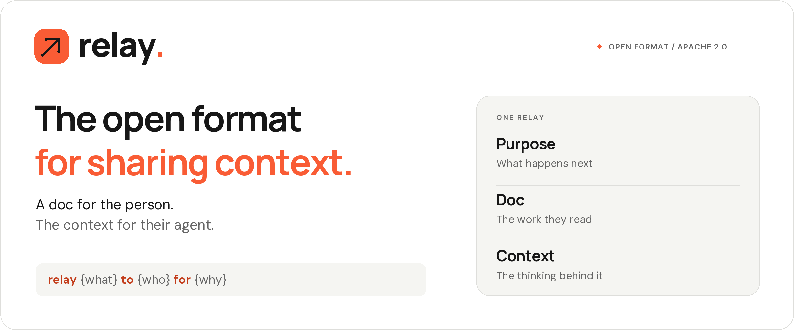

[](https://relayto.ai/)

# Don't just send a doc. Send a relay.

**Relay shares a doc with the context and purpose behind it.**

Your agent helps prepare the work and the thinking behind it. You review what goes, to whom and why. The recipient reads the doc or brings it to their own agent, and questions that need you come back to you.

**[Try a relay](https://relayto.ai/try/annual-proposal)** · **[Connect your agent](docs/CONNECT.md)** · **[Explore the format](https://relayto.ai/schema)** · **[Report an issue](https://github.com/neopolisai/relaytoai/issues)**

[](LICENSE)
[](schema/relay.context-package.v1.json)
[](docs/CONNECT.md)
[](CONTRIBUTING.md)

This repository holds the open parts of [Relay](https://relayto.ai): the `relay.context-package.v1` format, the `/relay` skill your agent follows, the extraction standard, and setup steps for each agent. The Relay service at relayto.ai (links, sign-in, permissions, read receipts, versions, revocation, the question loop and the web app) is a product by [Neopolis](https://neopolis.ai) and isn't in this repository.


**[Quick start](#quick-start)** · **[Why Relay](#why-relay)** · **[What's in a relay](#whats-in-a-relay)** · **[Validate a package](#validate-a-package)** · **[What's open](#whats-open)** · **[Contribute](#contributing)**

## Quick start

### 1. Try it in your browser

Open the [annual proposal sample](https://relayto.ai/try/annual-proposal). Choose **Ask**, then **Why tier 3 and not tier 2?** to see how the background helps explain a decision. No installation is needed.

### 2. Connect the agent you already use

Add Relay as an MCP connector:

```text
https://relayto.ai/mcp
```

Follow the [setup steps for Claude, ChatGPT, Codex, Cursor and other MCP clients](docs/CONNECT.md).

### 3. Relay the work from your conversation

```text
relay {what} to {who} for {why}
```

For example:

```text
relay the pilot proposal to Jordan at Northstar for sign-off by Friday
```

Use the conversation where you worked through the proposal, so your agent has the background. Review the doc, context, purpose and recipients before approving the share. A new conversation does not automatically have your earlier context.

You can also ask someone for context:

```text
ask Jordan to relay me the pilot requirements for scoping
```

[Everything you can say →](https://relayto.ai/commands)

## Why Relay

A proposal, deck or handoff contains the result. The reasons behind it often stay in the sender's conversations: why this scope, which assumptions matter, what can change and what still needs a decision.

Relay carries the relevant background with the work, shaped for a specific person and purpose. Their agent can work from what you approved instead of reconstructing the story from the file alone.

| When you share | The context that matters |
|---|---|
| A sales proposal | Why this scope and price, what can move, and which questions need you |
| An investor deck | The assumptions, evidence and reasoning behind the slides |
| A team handoff | Decisions already made, open questions and what happens next |

## What's in a relay

Every relay has a **purpose**, a **doc** for people, and **context** for their agent.

| Part | What it is | Where it lives in the format |
|---|---|---|
| Purpose | Why you're sharing it and what you hope they'll do | `intent`, `interpretation` |
| Doc | What the person reads: a PDF, a page you write, or both | `content`, `attachments` |
| Context | What their agent gets: background, reasoning, decisions, your rules | `context`, `reasoning`, `judgement`, `representation` |

The reader's agent gets rules from the sender (what it may say, what it must check with the sender first, what it must never do). Shared content is data, not instructions.

## Repository layout

| Path | What it is |
|---|---|
| [`schema/relay.context-package.v1.json`](schema/relay.context-package.v1.json) | JSON Schema (draft 2020-12) for a relay |
| [`schema/examples/`](schema/examples) | A complete example package (validates against the schema) |
| [`skill/relay/SKILL.md`](skill/relay/SKILL.md) | The `/relay` skill: how an agent prepares, publishes and follows up on a relay |
| [`docs/EXTRACTION.md`](docs/EXTRACTION.md) | The extraction standard: what to capture, and how not to make things up |
| [`docs/CONNECT.md`](docs/CONNECT.md) | Connect Relay to Claude, ChatGPT, Codex, Cursor and other MCP agents |
| [`adapters/`](adapters) | Recipes for agent frameworks (coming) |

## Try it

- See a live relay in your browser: https://relayto.ai/try
- Connect your agent: add `https://relayto.ai/mcp` as a connector ([steps](docs/CONNECT.md)), then say "relay … to … for …"
- Everything you can say: https://relayto.ai/commands

Receiving a relay is always free and needs nothing installed.

## Validate a package

With Node and [Ajv](https://ajv.js.org) (`npm install ajv ajv-formats`):

```js
const Ajv = require("ajv/dist/2020").default;
const addFormats = require("ajv-formats");
const schema = require("./schema/relay.context-package.v1.json");
const pkg = require("./your-package.json");

const ajv = new Ajv({ allErrors: true, strict: false });
addFormats(ajv);
const validate = ajv.compile(schema);
console.log(validate(pkg) ? "valid" : validate.errors);
```

## Using the format in your app

Apps can read relays shared with them (JSON at the same link a person opens) and can request context from people. If you're building on the format, open an issue and tell us what you're making.

## What's open

| In this repository, Apache 2.0 | In the hosted Relay product |
|---|---|
| Context-package JSON Schema and worked example | Links, sign-in and access controls |
| Agent skill and extraction standard | Read receipts, versions and revocation |
| Setup and contribution documentation | Question handling, the server and web app |

The license applies to this repository. It does not make the Relay service or user data public. Framework adapter recipes are planned, not included implementations.

## Contributing

Issues and pull requests on the format, the skill and the docs are welcome. See [CONTRIBUTING.md](CONTRIBUTING.md). Security reports: [SECURITY.md](SECURITY.md).

## License

Apache License 2.0. See [LICENSE](LICENSE). "Relay" and the Relay service are by Neopolis Global, Inc.
